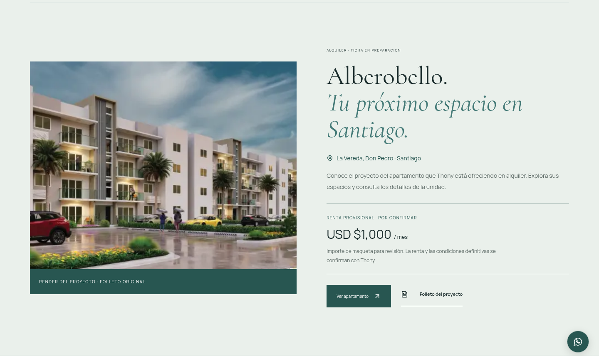
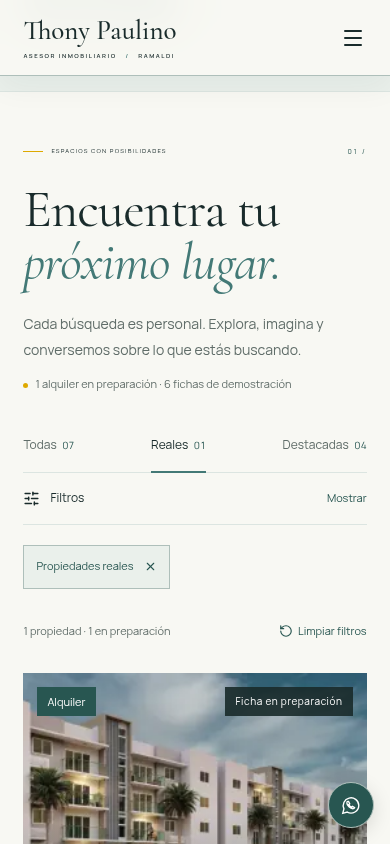
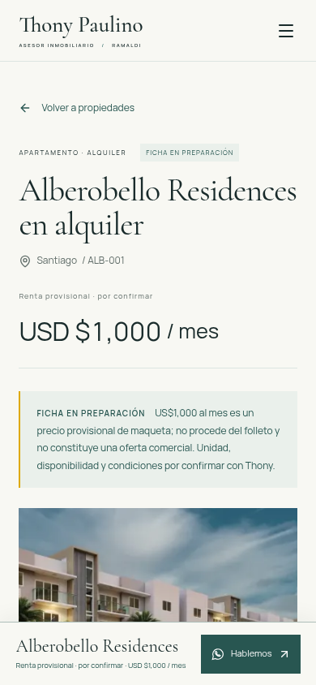
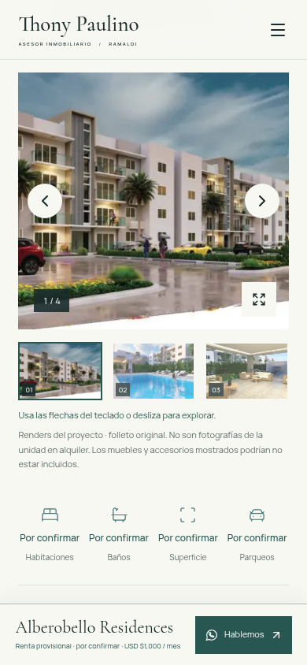
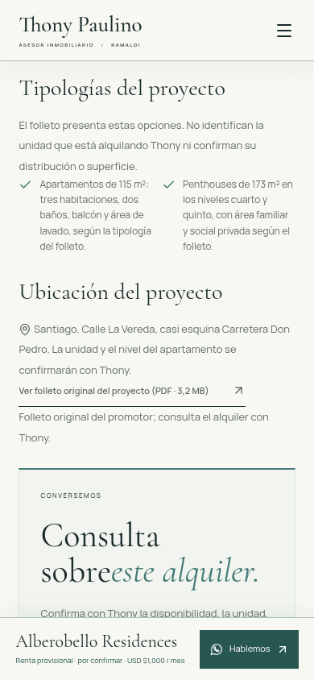

> Documento histórico del borrador anterior. La integración actual parte directamente del main de Claude y se documenta en AUDIT-INTEGRATION.md y HANDOFF.md. El PR #2 antiguo sigue separado.

# Revisión del borrador local de Alberobello

Fecha: 2026-10-18. Revisión combinada de navegación, presentación y riesgos de accesibilidad. Objetivo: descubrir el alquiler de Alberobello, entender la diferencia entre datos del proyecto y de la unidad y consultar a Thony.

Se capturó la compilación final local de Next.js en Chromium, a 1440 × 1000 y 390 × 844. Las capturas de este documento se generaron en esta revisión y se inspeccionaron después de decodificar las imágenes. Se utilizó movimiento reducido para comparar estados estables. No son capturas de la preview del PR ni de producción: esta continuación no se ha subido.

## 1. Portada — verificada

El nuevo bloque sitúa Alberobello antes de las demostraciones. Da acceso a la ficha y al folleto; la imagen se identifica como render y la renta de US$1,000 aparece marcada como provisional. El verde, dorado y fondo claro siguen las referencias del logo aportadas, con tonos profundos para texto y acciones. La [entrada móvil](audit/alberobello/01-home-mobile.png) mantiene imagen, título y ubicación en una columna; precio y acciones siguen al desplazarse.

Riesgo restante: el archivo original reutilizable del logo todavía no existe en el checkout; se mantiene el encabezado tipográfico. Los colores son una aproximación visual documentada en BRAND, no una guía corporativa certificada.

## 2. Catálogo — verificado

La selección **Reales** encuentra la ficha en preparación, mientras **Todas** conserva las siete fichas y **Destacadas** muestra cuatro. Las seis demostraciones mantienen su identificación. La retirada de la selección devuelve el foco a Todas; los resultados y filtros siguen accesibles por teclado.

El precio provisional queda fuera del filtro de presupuesto. Los datos desconocidos tampoco satisfacen el mínimo de habitaciones. Se explica ese comportamiento en la interfaz para evitar interpretar datos pendientes como cero o como valores confirmados. La ruta sin JavaScript conserva todos los enlaces.

## 3. Ficha y consulta — verificadas, contenido provisional

La revisión detectó que el título y una advertencia larga desplazaban demasiado la imagen en móvil. Se compactó únicamente la cabecera de la ficha real y se acortó el aviso, conservando explícitos el origen provisional del importe y la ausencia de oferta comercial confirmada. El render comienza dentro de la primera pantalla de 390 × 844. En [escritorio](audit/alberobello/03-detail-desktop.png), la consulta se presenta junto a la galería; en móvil permanece al pie con espacio reservado.

La galería identifica los cuatro renders del proyecto y advierte que no son fotografías actuales de la unidad ni confirman mobiliario incluido. Los cuatro datos desconocidos se muestran **Por confirmar**. Se probaron teclado, ampliación, foco, carga y navegación entre los renders; la recuperación de errores de imagen y el gesto táctil conservan sus regresiones.

Los 115 m² y 173 m² aparecen dentro de **Tipologías del proyecto**, con una advertencia que evita atribuirlos a la unidad. El PDF se identifica como folleto del promotor; el alquiler se consulta con Thony. El enlace entrega exactamente el archivo aportado, comprobado por SHA-256. WhatsApp pide confirmar renta, unidad, disponibilidad, condiciones y fotografías actuales, sin enviar mensajes durante las pruebas.

## Comprobaciones y límites

- Lint, TypeScript y build de producción aprobados.
- Suite final completa: **57 aprobadas, 1 omitida por no aplicar, 0 fallidas**. La omisión corresponde al menú móvil en el proyecto de escritorio.
- Axe sin infracciones detectadas en los estados probados de portada, fichas y menú. Sin desbordamiento en 360, 390, 768, 844 y 1440 px. Se incluyen las rutas de Alberobello y demostración, foco, teclado, movimiento reducido y contenido sin JavaScript.
- Los contrastes sólidos están documentados en BRAND; las capturas y axe no certifican accesibilidad completa. No se han medido nuevos Web Vitals ni probado Safari, dispositivos físicos o entrega de mensajes.

Antes de publicar sigue siendo necesario confirmar la unidad, renta definitiva y condiciones, revisar la disponibilidad y recibir fotografías actuales. Los renders y el folleto no prueban el estado actual del apartamento. El borrador mantiene `noindex`, exclusión de sitemap y robots, y permanece sin commit, push ni despliegue.
