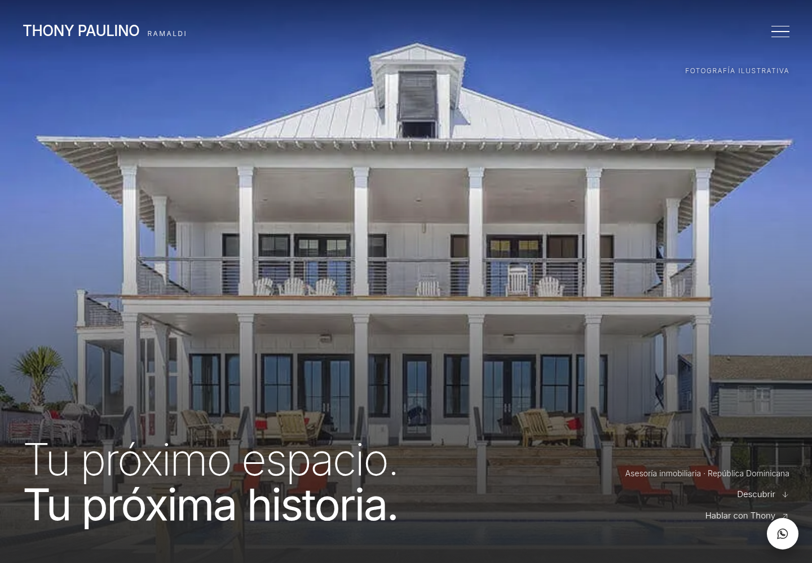
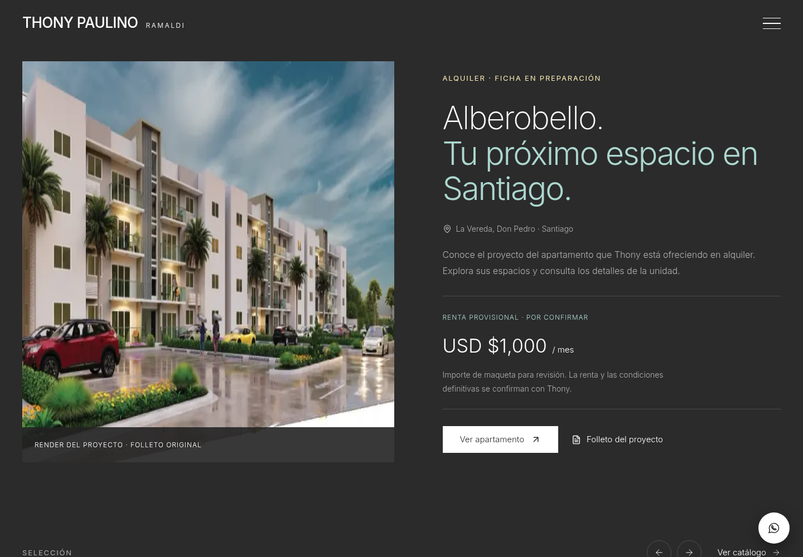
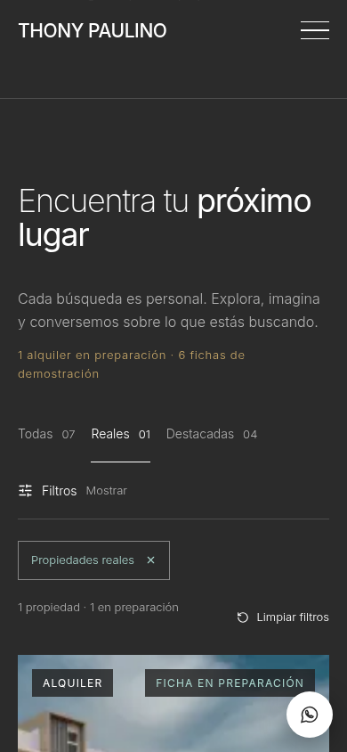
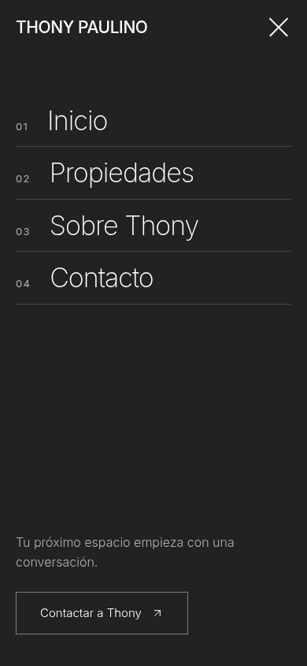
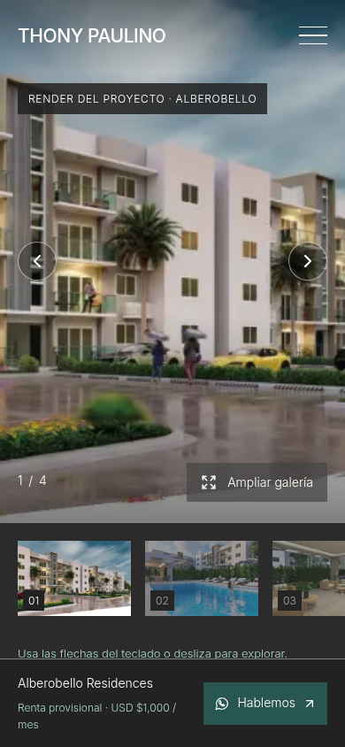
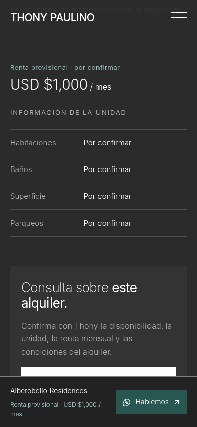

# Integración sobre el diseño de Claude

Fecha: 2026-10-18. Base revisada: main `d0f5f09`, que integra el PR #3 de Claude. Rama de entrega: `feat/ramaldi-alberobello-integrated`, código en `6260099`. Objetivo: conservar su diseño oscuro y añadir Alberobello y las mejoras funcionales del borrador.

Las capturas siguientes se generaron e inspeccionaron durante la revisión de la compilación final local, con Chromium a 1440 × 1000 y 390 × 844, imágenes decodificadas y movimiento reducido. No son capturas de producción ni de los informes históricos del diseño claro. La entrega posterior se realiza mediante PR y Preview autorizados por el usuario; sus resultados remotos se consultan en GitHub.

## 1. Portada y alquiler destacado — verificados

Se mantienen Inter, fotografía a pantalla completa, titular, menú y estructura de Claude. La portada existente solo incorpora el bloque de alquiler y un acceso directo a hablar con Thony; la presentación centrada, carrusel y resto de secciones permanecen. No se cambian sus dependencias, reglas, icono, páginas de error ni Open Graph.

El nuevo bloque usa la misma tipografía y fondo carbón. Los acentos Ramaldi se limitan al dorado claro de la etiqueta, el verde claro legible y el CTA contextual verde profundo. US$1,000 aparece identificado como provisional, con explicación y acceso a ficha y folleto. La imagen se identifica como render del proyecto.

Riesgo pendiente: los archivos reutilizables de logo y retrato siguen ausentes. Los renders tienen la resolución original del folleto y no sustituyen fotografías actuales de la unidad.

## 2. Carrusel, catálogo y menú — verificados

Se conserva el carrusel nativo de Claude; sus etiquetas ahora distinguen el alquiler en preparación de las seis demostraciones. Las flechas se mantienen en escritorio y el desplazamiento nativo en móvil, como en el diseño base. Sin JavaScript se ocultan los botones que requieren script, manteniendo desplazamiento y enlaces.

El catálogo suma selección Reales, filtros retirables, conteos derivados y transiciones con salidas inertes. Los importes provisionales no participan en presupuesto y los datos null no satisfacen mínimos numéricos. En móvil se corrigió la alineación del icono y texto de Filtros sin cambiar el diseño del control.

El menú conserva la presentación de Claude en todos los tamaños. Se añaden fondo inerte, control de foco y salidas inaccesibles; existen enlaces alternativos sin JavaScript. Las pruebas ahora ejercitan el menú también en escritorio: ya no se omite ese caso como en la fase anterior.

## 3. Galería, información y contacto — verificados; datos comerciales provisionales

La galería conserva el tamaño y presentación inmersiva. Añade identificación visible del render desde su apertura, teclado normal/ampliado, Home/End, gesto horizontal, carga/error/reintento y enlaces originales sin JavaScript. El diálogo nativo conserva cierre con Escape, foco y bloqueo del fondo.

Se conserva la tabla de información de Claude. Los datos de unidad desconocidos se muestran Por confirmar, sin texto null ni atribuir a la unidad las tipologías de 115 m² o 173 m² del proyecto. La renta provisional está identificada; el PDF se presenta como folleto del promotor y las consultas se dirigen a Thony. La CTA móvil permanece visible y reserva espacio al final del pie.

## Validación y límites

- Instalación mediante npm ci con el lockfile de Claude, lint, tipos y build: aprobados.
- Suite final sobre la compilación combinada: **62 aprobadas, 0 omitidas y 0 fallidas**. Incluye todas las rutas, seis demostraciones, real en preparación, PDF original comprobado por hash, WhatsApp, filtros, carrusel, teclado, foco, gestos, errores, preferencias de movimiento y no JS.
- Axe sin infracciones detectadas en los estados probados de portada, fichas y menú. Sin overflow en los anchos 360, 390, 768, 844 y 1440 px. No implica certificación completa de accesibilidad.
- Se corrigió una prueba nueva que intentaba pulsar flechas ocultas en móvil; ahora comprueba el desplazamiento nativo, conservando el comportamiento de Claude. No se retiraron comprobaciones de navegación.
- Los contrastes de los nuevos acentos sólidos se documentan en BRAND. No se han medido Web Vitals de campo ni probado Safari o dispositivos físicos ni enviado mensajes reales.

La rama parte directamente del main revisado, evitando la combinación conflictiva del PR #2 antiguo. El fetch anterior al commit mantuvo main en `d0f5f09`. El borrador anterior y su memoria están respaldados; la historia de Claude se conserva en HANDOFF y CHANGELOG. Código, pruebas y activos quedaron guardados en `6260099`.

El usuario autorizó publicar la rama y crear el PR para revisar la Preview automática de Vercel. El flujo hacia producción se documenta en README: revisar los checks y fusionar el PR a main; esta tarea no lo fusiona. Antes de un lanzamiento comercial siguen pendientes la renta definitiva, unidad, condiciones, disponibilidad y fotografías actuales. El importe provisional no es una oferta confirmada.
