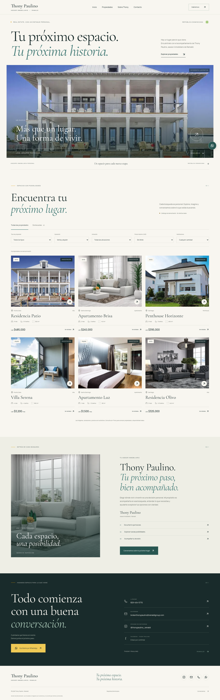
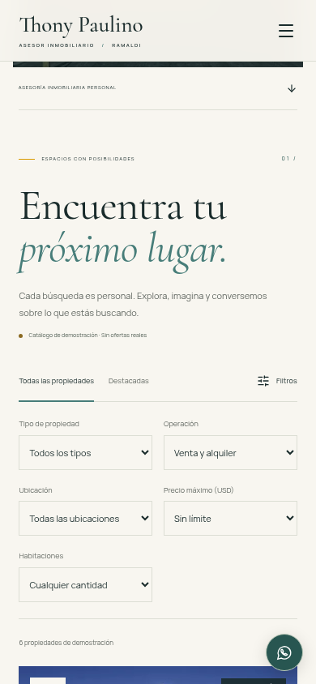
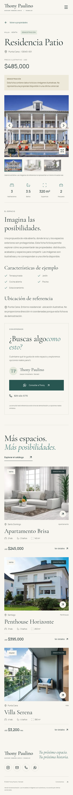

> Revisión histórica previa al rediseño de Claude. Para el estado actual, ver AUDIT-INTEGRATION.md.

# Auditoría y evolución de experiencia — Fase 2

Fecha: 2026-10-18. Objetivo: encontrar una propiedad de demostración, comprender su ficha y contactar a Thony sin fricción; evolucionar la dirección cinematográfica sin reemplazar la aplicación.

## Alcance y evidencia

Se inspeccionaron la portada, el catálogo y una ficha del sitio publicado y de la compilación local de la fase 1, a 1440 × 1000 y 390 × 844 en Chromium. Las capturas se produjeron en esta sesión; se desplazaron y decodificaron las imágenes lazy antes de aceptar capturas completas. Los logotipos y el retrato continúan ausentes.

Chromium directo rechazó el certificado de los sitios públicos en este entorno. Se capturó su contenido mediante respuestas de Playwright APIRequestContext, usando el proxy HTTPS existente con validación TLS y entregándolas a Chromium sin cambiar el origen de las páginas. No se desactivó TLS ni se modificó el almacén de confianza. Este transporte permite revisar contenido e interacciones, pero no representa el rendimiento de la red pública.

Se revisó visualmente Maddock, incluyendo su pantalla estable después de la introducción. Su fotografía protagonista, espacio y ritmo sirvieron de inspiración. No se copió código, imágenes ni identidad de ese sitio ni se usaron otras marcas llamadas Ramaldi.

## Recorrido auditado

### 1. Portada — funcional, con oportunidad de jerarquía y movimiento

Fortalezas: identidad cromática coherente, tipografía editorial y contacto real. La composición separaba el título de la fotografía y su movimiento consistía principalmente en un keyframe de imagen. La fotografía local de 800 × 562 limita el detalle en pantallas grandes; ampliarla no añade resolución.

Acción implementada: hero inmersivo con una capa de contraste, dos acciones explícitas, título por líneas, transición coordinada con la puerta y parallax de 42 px solo en escritorio con puntero preciso y cuando la sección está visible. En móvil y con movimiento reducido se omite ese efecto. Se conserva contenido SSR visible.

### 2. Catálogo — filtros correctos, lectura y transiciones mejorables

Los cinco filtros funcionaban y las advertencias de demostración eran visibles. Sus etiquetas y características se presentaban con texto pequeño; el reemplazo de resultados era inmediato. La selección completa de seis tarjetas hace largo el recorrido móvil, por lo que son importantes los accesos de navegación y el contacto persistente, sin esconder propiedades.

Acción implementada: controles y precios más legibles, filtros activos retirables, foco conservado, conteo de destacados derivado, venta/alquiler diferenciados y transiciones breves. Las tarjetas retiradas pasan a `inert` y quedan fuera del árbol accesible durante su salida. El catálogo completo mantiene enlaces navegables sin JavaScript y explica la disponibilidad del filtrado. La imagen principal de Penthouse Horizonte se cambia a una vista de balcón de referencia y Villa Serena a una fachada, conservando todas las fichas como demostración.

### 3. Ficha — información completa, contacto móvil demasiado distante

La galería y el diálogo funcionaban, pero sus controles móviles eran pequeños y las flechas del teclado solo actuaban en el diálogo. El contacto principal aparecía después de descripción y características, lejos del inicio de la ficha móvil. No existía una salida explícita si fallaba una fotografía.

Acción implementada: controles de al menos 44 px, teclado en galería normal y ampliada, gesto horizontal que conserva el desplazamiento vertical, carga y error reales con reintento, alternativas sin JavaScript y una consulta contextual persistente en móvil con espacio reservado al pie. Se amplían tamaños de descripción, características y precio. El diálogo nativo conserva Escape, foco y bloqueo del fondo.

## Integridad y despliegue

- `origin/main` revisado: `106e9ced92847bfd2125535f3bd94e113a998a94`, merge del PR #1. Su árbol coincide con la fase 1 publicada previamente; no se encontraron cambios adicionales atribuibles a Claude/Yordi Lewis.
- GitHub informó `Vercel: success`, “Deployment has completed”, para ese SHA, con destino `https://vercel.com/los-yordis/thony-ramaldi/FMXAbD8AkqwuxxoVwtXqEA5dPnkF`. El check `quality` del mismo SHA también estaba aprobado.
- El listado GitHub deployments devolvió `[]`. No existe evidencia suficiente para afirmar que el alias `thony-ramaldi.vercel.app` apunta exactamente a ese SHA; el contenido observado sí coincide con la fase 1.
- Se trabaja en `feat/thony-phase-two`; no se modifica main ni se publica manualmente a producción.

## Verificación y límites

Las capturas permiten evaluar composición y riesgos visibles, no certificar accesibilidad completa. Se acompañan de pruebas de teclado, foco, estados de error, navegación sin JavaScript, axe y tamaños responsive. Los resultados finales se registran en HANDOFF y CHANGELOG. No se han probado dispositivos físicos ni Safari ni enviado mensajes, llamadas o correos reales.

El laboratorio observó tres cargas locales nuevas por tamaño, sin throttling, esperando `networkidle` + 2800 ms en cada contexto. La columna de desplazamientos suma las entradas observadas sin interacción; no calcula las ventanas de sesión del CLS oficial. Son muestras pequeñas y locales: no Lighthouse, Core Web Vitals de campo ni una medida de redes móviles.

| Observación local, mediana | Fase 1 | Fase 2 |
| --- | --- | --- |
| LCP escritorio | 240 ms | 336 ms |
| LCP móvil emulado | 176 ms | 236 ms |
| Suma de desplazamientos, escritorio | 0.001153 | 0.001569 |
| Suma de desplazamientos, móvil emulado | 0 | 0 |

El aumento de estas muestras no demuestra una regresión general ni una mejora de rendimiento. Se mantiene el trabajo visual acotado, sin dependencias adicionales; faltan mediciones en el despliegue y dispositivos reales.

Observaciones originales: [fase 1](audit/phase-2-lab-baseline.json) y [fase 2](audit/phase-2-lab-final.json). Se emplearon contextos nuevos, DPR 1, `isMobile` según el tamaño, sin sobrescribir user agent, `hasTouch` ni preferencia de movimiento; observadores registrados antes de navegar.

## Resultado después de implementar

1. **Portada: verificada.** Captura [escritorio](audit/phase-2-after-home-desktop.png) y [móvil](audit/phase-2-after-home-mobile.png), con imágenes decodificadas y movimiento reducido para comparar estados finales estables.
2. **Catálogo: verificado.** Captura de [filtros móviles](audit/phase-2-after-filters-mobile.png); selección, retirada, foco, estado vacío, alquiler y destacados comprobados.
3. **Ficha: verificada.** Captura [móvil](audit/phase-2-after-detail-mobile.png), con contacto persistente y reserva al final; teclado, swipe, fallo y recuperación de fotografía comprobados.

Lint, TypeScript y build de producción aprobados. Playwright: **43 aprobadas, 1 omitida por no aplicar, 0 fallidas**. Axe no detectó infracciones en los estados probados de portada, ficha y menú móvil. No se modifica la afirmación de límites: estas pruebas no certifican accesibilidad completa ni compatibilidad de todos los dispositivos.

Para un lanzamiento comercial siguen pendientes los originales de marca, retrato y fotografías autorizadas de mayor resolución, inventario real y Facebook confirmado. No se han inventado mapas, recorridos 3D, estadísticas ni credenciales.
