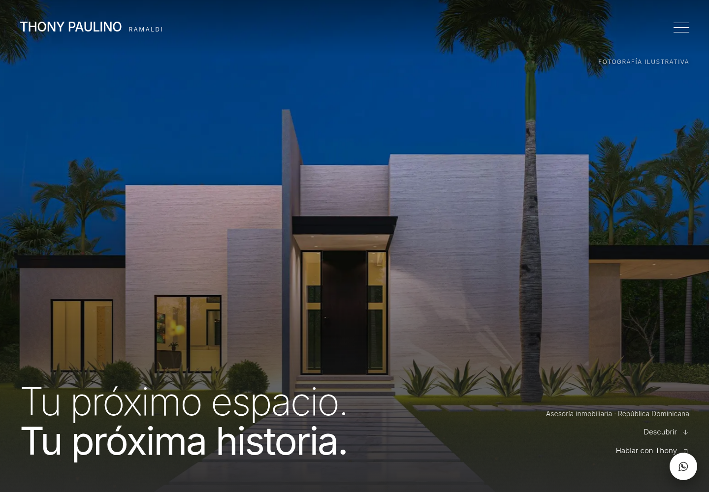
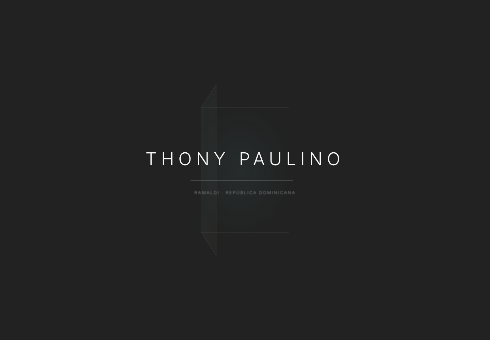
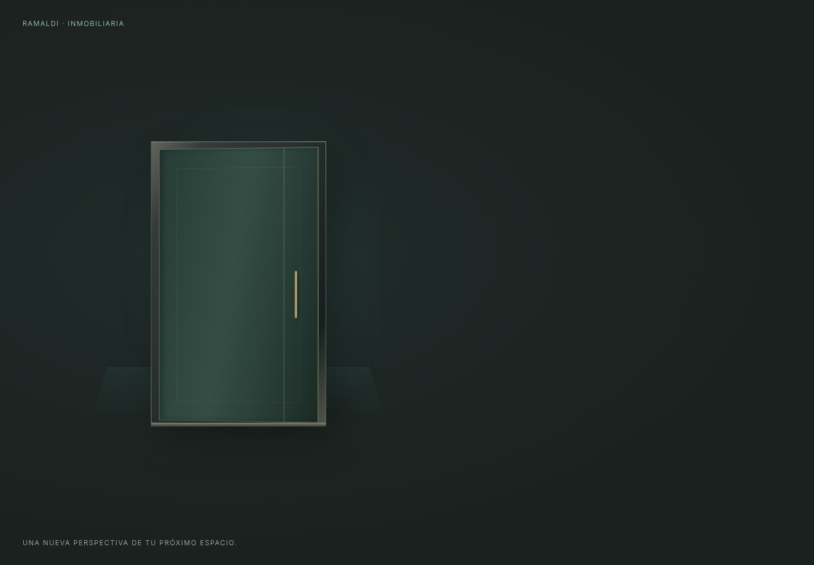
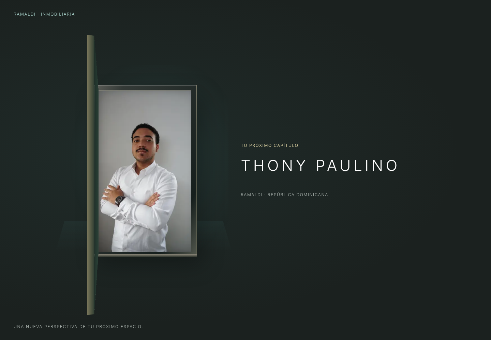
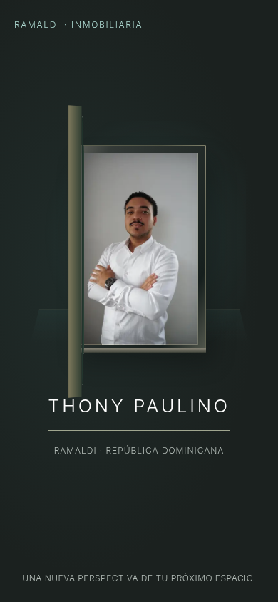
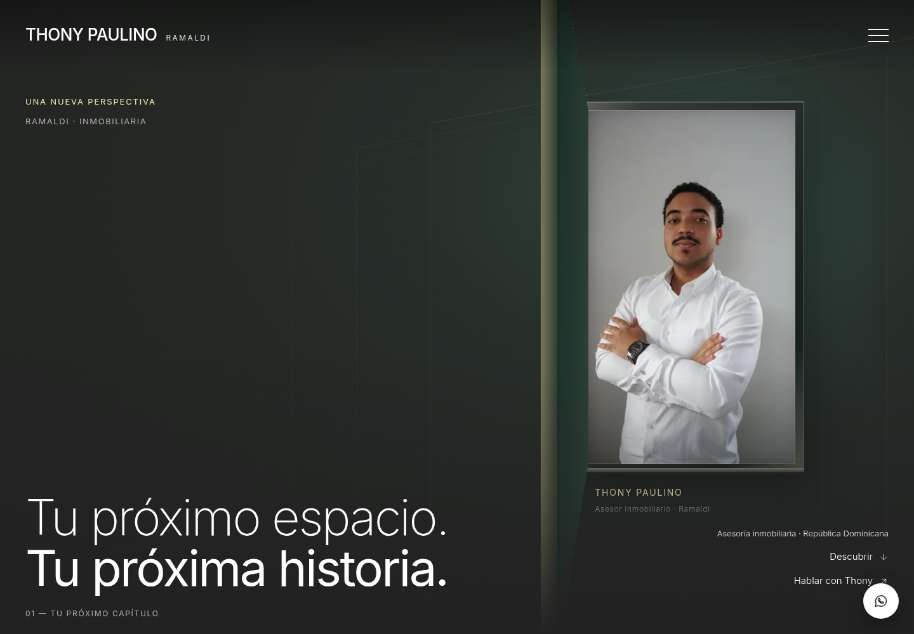
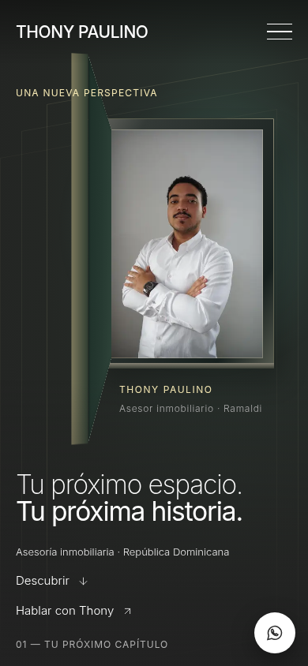
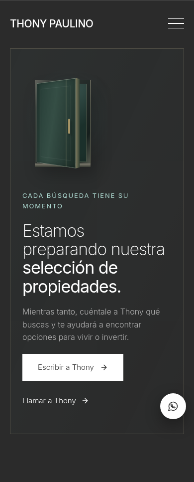
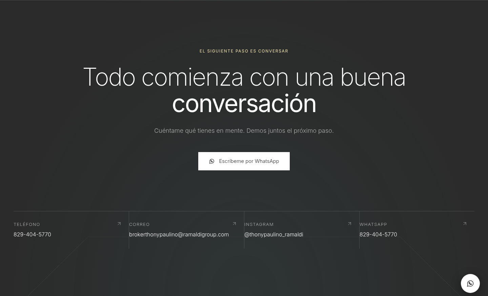
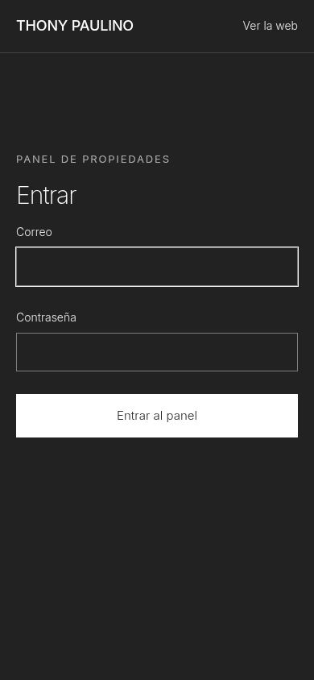

# Evolución cinematográfica sobre el trabajo de Claude

2026-10-18. Base revisada: main `0742704`, que fusiona el PR #5; el PR #4 anterior también está fusionado. Rama: `feat/cinematic-ramaldi-experience`, en el mismo checkout. Implementación: `7ce368a`. Se revisaron commits, documentación, rutas, assets, datos y experiencia antes de editar, y se repitió el fetch al cerrar.

Claude ya había incorporado el panel Supabase, el retrato oficial, la portada elegida por Yordi Lewis y la eliminación de Facebook. Se conservan el panel, autenticación, subida de fotografías, acciones de publicación, tipos, mapeo de filas, esquema y RLS. No se cambiaron dependencias, configuración de Next, dominio ni proyecto Vercel. El nuevo brief amplía expresamente el alcance de la mejora anterior del preloader a la presentación pública completa.

## 1. Revisión inicial — completada

La portada empleaba una fotografía ilustrativa correctamente identificada y la entrada tenía un marco tenue detrás del nombre. El nuevo brief pide una puerta sólida y evitar viviendas ajenas como contenido comercial. Se conserva la foto elegida y su procedencia en el repositorio, y se cambia su uso público por arquitectura de marca y el retrato autorizado.

La lectura anónima del proyecto oficial de Supabase respondió HTTP 200 con **cero publicaciones**. La compilación y las capturas públicas de esta revisión utilizan ese estado real, sin crear ni importar propiedades.

## 2. Entrada arquitectónica — verificada en escritorio y móvil

La hoja incluye caras, espesor, tirador, herraje visual, marco y umbral. Abre sobre su borde con perspectiva CSS, sin WebGL ni motor 3D. Los gradientes y sombras son estáticos; se animan transform y opacity. La versión móvil tiene otra escala, separación entre retrato y texto y apertura menos pronunciada.

Se revela el retrato oficial como **fotografía sobre un plano**. No se generan personas, cuerpos ni movimiento corporal, y no se presenta una foto como una filmación. No existe un video autorizado de entrada. Las referencias del logo están visibles en el chat, pero falta el archivo reutilizable; la identidad tipográfica se conserva y `site.logo` queda preparado, con recuperación si un futuro archivo falla.

La lógica conserva una vez por sesión, primera entrada por `/`, protección de llegada por SPA desde una ficha, memoria si storage está bloqueado, teclado/toque/rueda para saltar, pestaña oculta, movimiento reducido y ausencia de overlay sin JS. Secuencia de 1,6 s y salida de 0,5 s: 2,1 s normales; máximo absoluto 5 s, también por CSS. Solo se espera el hero decodificado y las fuentes; si tardan, respira la línea sin repetir la puerta. La escena está memoizada para no reconstruirla en cada cambio de fase.

## 3. Hero y movimiento coordinado — verificados

El titular, acciones, menú completo, Inter y fondo oscuro mantienen continuidad con Claude. El retrato y la arquitectura de marca reemplazan el uso de una vivienda ilustrativa como portada. El relevo de la entrada activa el revelado de título, navegación e imagen; la base permanece visible si el evento o JavaScript fallan.

La profundidad interactiva se limita a puntero fino y pantallas amplias. No se inicia con movimiento reducido, ahorro de datos o memoria declarada de 4 GB o menos. Se pausa fuera de pantalla y al ocultar la pestaña; cancela frames y listeners al desmontar. Solo solicita un frame al recibir movimiento o scroll, sin bucle permanente. Los móviles conservan una composición estática y el movimiento inicial breve. Los CSS públicos se importan en `(site)/layout.tsx`, fuera del panel.

El menú añade una entrada escalonada y conserva foco, Escape, fondo inerte, salidas inaccesibles y navegación sin JS. Los revelados diferencian texto, imagen y contacto. La preferencia de movimiento reducido cancela también un revelado iniciado.

## 4. Inventario auténtico y estado vacío — verificados

Se presenta “Estamos preparando nuestra selección de propiedades”, con arquitectura de marca y contacto por WhatsApp/teléfono. No se insertan filas en Supabase ni anuncios de ejemplo en producción. `getProperties()` conserva su lectura publicada, caché y manejo de errores, añade exclusión de registros demo y deja el catálogo vacío si Supabase está desactivado.

Las fixtures requieren `THONY_TEST_FIXTURES=1` durante build y ejecución, con Supabase desactivado y sin `VERCEL_ENV`. El despliegue Vercel nunca las habilita. Una segunda compilación de CI, sin fixtures, comprueba catálogo vacío, contacto, imágenes auténticas y 404 de las rutas de prueba. La importación de Alberobello del panel se conserva; no se ejecutó durante esta tarea. Sus datos definitivos siguen pendientes del propietario.

## 5. Thony, propiedades y contacto — verificados

El retrato entregado se mantiene, con encuadre, plano y leyenda editorial. No se inventan biografía ni credenciales. Las tarjetas tienen profundidad moderada en hover de escritorio; se conservan los filtros, galerías, gestos, recuperación de imágenes, etiquetas, datos por confirmar y consultas contextuales. En la web real solo se renderizan publicaciones no demo; las regresiones con ejemplos se ejecutan aisladas.

El contacto conserva todos los destinos oficiales y gana un fondo geométrico, revelado y microinteracciones. El pie mantiene el nombre grande y navegación, usando planos de marca en lugar de una vivienda ilustrativa. Su aviso conserva precios/disponibilidad por confirmar, sin describir la web pública como una demostración.

## 6. Panel y Supabase — preservados; alcance de la comprobación

Con el proyecto real configurado, una visita anónima a `/admin` redirigió a `/admin/login`, conservando el formulario y noindex. No incluye hero, puerta, cabecera ni pie públicos. Con Supabase desactivado se comprobó también el aviso de activación. No hay cambios en `src/app/admin/**`, `src/proxy.ts`, clientes Auth, `property-row.ts` ni `supabase/schema.sql`.

No se utilizaron credenciales del propietario, ni se probaron login autenticado, altas, edición, borrado, subida o publicación contra la base real. La preservación de esas funciones se sustenta en el código sin cambios y regresiones aplicables, no en afirmar operaciones reales que no se ejecutaron.

## 7. Validación y rendimiento — evidencia y límites

Instalación con `npm ci` usando el lockfile de main, lint, typecheck y builds de producción aprobados. Regresiones Chromium: **82 aprobadas, 0 omitidas, 0 fallidas**, incluyendo las 76 de main y seis ejecuciones nuevas de escena, profundidad y ahorro de datos. La compilación pública separada, sin Supabase ni fixtures, obtuvo **6 aprobadas, 0 omitidas y 0 fallidas**, comprobando ausencia de ejemplos y aislamiento del panel. Se comprobaron también esos seis casos con configuración real y catálogo vacío. Resultados del nuevo PR en sus checks; no atribuir los resultados de los PR anteriores a este código.

En una primera comprobación pública, axe detectó que el nombre accesible del enlace de marca no incluía exactamente su texto visible en escritorio. Se corrigieron el nombre y la separación entre palabras; se repitió la suite sin retirar comprobaciones.

Lighthouse 13.5, Chromium 154, emulación móvil y throttling simulado, servidor local de producción y catálogo vacío. [Datos y configuración](audit/cinematic/lighthouse.json):

| Métrica | Main de Claude | Evolución optimizada |
| --- | ---: | ---: |
| Performance | 92/100 | 92/100 |
| Accessibility automática | 100/100 | 100/100 |
| FCP | 1,391 s | 1,385 s |
| LCP | 3,102 s | 3,125 s |
| Total Blocking Time | 98 ms | 67 ms |
| CLS | 0,00079 | 0 |
| Transferencia | 338.970 bytes | 333.275 bytes |

La primera iteración midió 76/100 y 727,5 ms de TBT. Se aisló el render de la escena, se limitaron selectores de animación y se evitó preparar observadores en dispositivos no elegibles; la comprobación final recuperó el resultado inicial. Se cerraron servidores de revisión previos antes de la medición final. El JSON conserva también la iteración intermedia: no se oculta la regresión detectada.

Son corridas de laboratorio, sujetas a variación, no Web Vitals de campo ni pruebas de un Moto G físico. El LCP sigue alrededor de 3,1 s bajo esa simulación y puede mejorarse. No se afirma compatibilidad medida en Safari, iPhone/Android físicos, GPU o batería de gama baja, ni certificación completa de accesibilidad. Las capturas son locales, guardadas e inspeccionadas en esta revisión: 1440×1000 y 390×844, más recorte del retrato móvil. Las capturas de la entrada muestran fases de su animación; no son renders generados.

## Archivos y continuación para Claude

- Escena: `architectural-door.tsx`/módulo CSS, `preloader.tsx`, `hero.tsx`, `depth-plane.tsx`, `cinematic.css`, tokens de `src/lib/motion.ts`.
- Integración pública: `(site)/page.tsx`, `(site)/layout.tsx`, bloque de entrada retirado de globals.css, menú, Reveal, estado vacío y pie. Datos: guardia de fixtures y filtro no demo en `get-properties.ts`.
- Pruebas: `tests/cinematic.spec.ts`, adaptación de la imagen crítica en `tests/preloader.spec.ts`, `tests-public/`, `playwright.public.config.ts`, flag del servidor de pruebas y doble build en CI. Configuración de Supabase solo aclara comentarios; los valores públicos del proyecto no se cambian.
- README, AGENTS, CLAUDE, CHANGELOG, HANDOFF, ROADMAP, PRELOADER y ASSETS registran el estado actual, conservando historia de ambos asistentes.

Pendientes auténticos: SVG/PNG reutilizable del logo, preferiblemente con transparencia y versión clara; datos/fotos verificadas de las futuras publicaciones y revisión de contenido por el propietario. Un video real de entrada es opcional: si se proporciona, debe ser una grabación autorizada y breve, con versión móvil y poster. La escena admite contenido en su plano interior; no se integra un clip sintético para suplirlo. Revisar dispositivos reales y operaciones autenticadas del panel antes de afirmar validación completa.

La entrega utiliza una rama de desarrollo y el proyecto Vercel existente. No se cambia el dominio ni se fusiona automáticamente a main.
