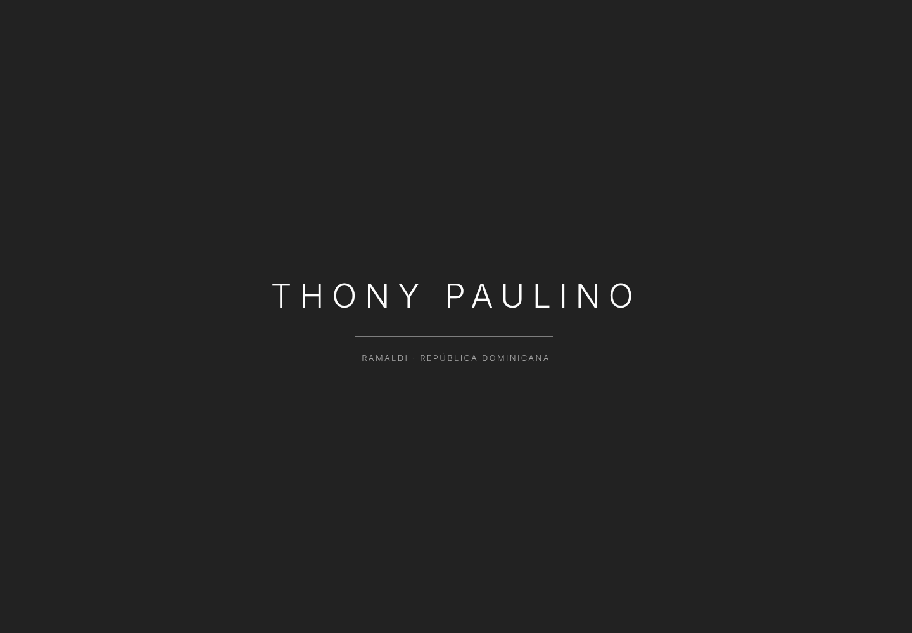
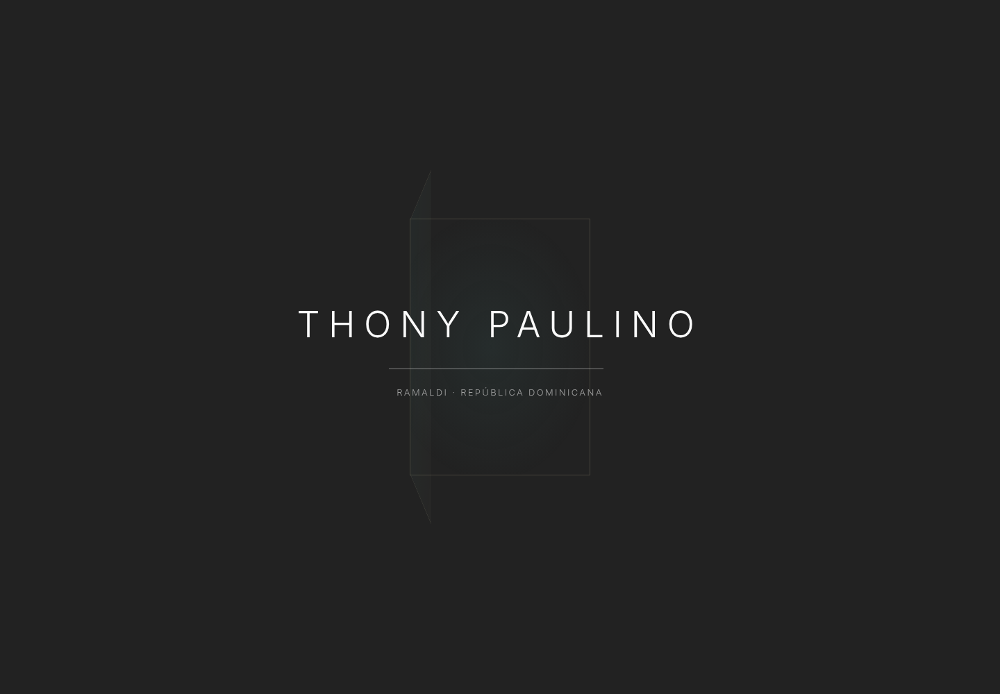
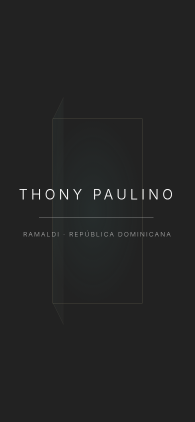
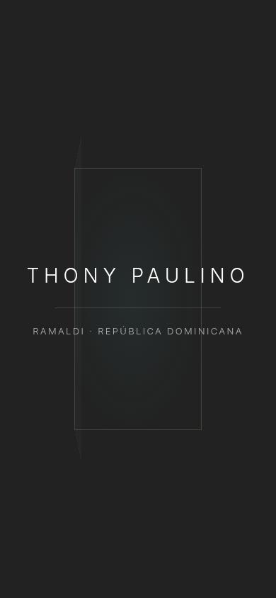

# Mejora acotada de la introducción

Revisión del 2026-10-18, implementación `a5ae5b8`. Se consultaron GitHub y los cambios existentes antes de editar: main seguía en `d0f5f09`, el PR #4 permanecía abierto y su rama en `c3e256e`. La continuación conserva toda la integración de Alberobello y el diseño oscuro de Claude.

## Qué se conserva y qué se adapta del texto

El usuario indicó que el texto adjunto no debía reemplazar lo construido. Se conservan Inter, fondo carbón, nombre THONY PAULINO, línea, leyenda, entrada tipográfica, montaje exclusivamente en la home y la marca de sesión `thony-entry`. La puerta pasa a ser un detalle geométrico detrás del texto, con perspectiva y apertura CSS una sola vez. No se recupera la antigua puerta de la versión clara ni se introduce una nueva escena que sustituya la composición de Claude.

Se descartan cambios de portada, catálogo, propiedades, navegación, datos, marca o dependencias. No se inventa el logo: `site.logo` sigue vacío y se mantiene la identidad tipográfica existente. Cuando se configure un archivo autorizado, el componente lo mostrará con `next/image`; si falla, recuperará el texto. Elegir un archivo que contraste con el fondo oscuro. No se promete fluidez en todos los dispositivos sin medirlos.

## Lógica

- Solo puede comenzar si el documento inicial se abrió en `/`, la pestaña está visible, no se prefiere movimiento reducido y la sesión no vio la introducción. Se usa Navigation Timing para distinguir una entrada inicial de una llegada por SPA desde una ficha; si no está disponible, se omite la introducción.
- Se conserva una vez por sesión, incluso al refrescar. El texto permitía repetir al refrescar, pero no lo exigía; se mantiene la regla existente. La memoria del módulo evita repeticiones de navegación cuando sessionStorage está bloqueado. La decisión se conserva en un ref para tolerar el ciclo adicional de efectos de Strict Mode.
- La secuencia dura 1,7 segundos y la salida 0,6 segundos cuando la primera pantalla está lista. Se esperan la carga/decodificación de `.hero-image` y `document.fonts.ready`, sin esperar las imágenes lazy ni recursos del resto del sitio.
- Si siguen pendientes, solo respira la opacidad de la línea. La puerta y el texto no reinician sus animaciones. Al completarse o fallar la imagen, se permite la salida; los errores de decodificación tampoco retienen el contenido.
- A los cinco segundos se desmonta aunque siga pendiente un recurso. CSS también oculta el overlay a ese límite si la actualización de React falla. No se anima con JavaScript por frame ni se bloquea el scroll.
- Teclado, toque/clic o rueda permiten saltarla inmediatamente. Ocultar la pestaña o activar movimiento reducido también la retira. El overlay es decorativo y aria-hidden; no captura foco y no intercepta eventos. Sin JavaScript no se renderiza.

## Evidencia visual actual

Capturas guardadas e inspeccionadas en esta revisión, usando Chromium, 1440 × 1000 y 390 × 844. La animación se capturó aproximadamente 800 ms después de aparecer. Corresponden a compilaciones locales de producción, no a capturas autenticadas de Vercel.

### 1. Composición conservada — verificada

El nombre, la línea y la leyenda mantienen su posición y jerarquía. Se añade únicamente el marco y la apertura geométrica, en tonos suaves de Ramaldi. No se presenta la identidad tipográfica como si fuera un logo oficial.

### 2. Carga lenta real — verificada

La solicitud de la imagen principal se mantuvo pendiente. La introducción pasó al estado de espera y conservó la puerta abierta; solo la línea repite una animación de opacidad. Las pruebas comprobaron la salida al liberar la solicitud, al fallar la imagen y al agotarse el límite de seguridad.

### 3. Acceso al contenido — verificado

La portada y sus controles conservan su diseño. No se modificaron sus componentes, imágenes, filtros, fichas ni contactos. No se detectaron errores de aplicación ni overflow en las dos capturas de salida.

## Validación y límites

Lint, typecheck y build aprobados. `CI=true npm test`: **72 aprobadas, 0 omitidas, 0 fallidas**, Chromium escritorio y móvil. Las diez ejecuciones nuevas cubren llegada por SPA desde una ficha, espera de imagen, error, recurso que no termina y salida con teclado. Se conservaron las 62 comprobaciones anteriores, incluidas sesión/refresh, storage bloqueado, movimiento reducido inicial y dinámico, no JS, accesibilidad automática y regresiones de catálogo/fichas.

No se han probado Safari, teléfonos físicos de gama baja, consumo de GPU ni Core Web Vitals de campo. El renderizado del logo original queda pendiente de recibir el archivo. Los resultados de Vercel y GitHub Actions de esta continuación se consultan en el PR #4; las verificaciones anteriores del PR correspondían a otro commit.

Archivos de aplicación modificados: `src/components/preloader.tsx` y exclusivamente el bloque de entrada de `src/app/globals.css`. Pruebas nuevas en `tests/preloader.spec.ts`. La documentación compartida registra la continuación para Claude / Yordi Lewis. No se fusiona automáticamente a main.
